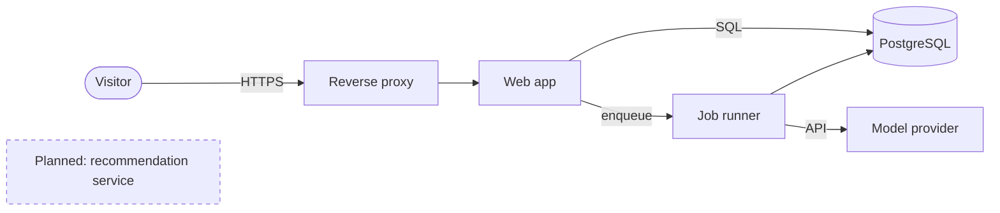
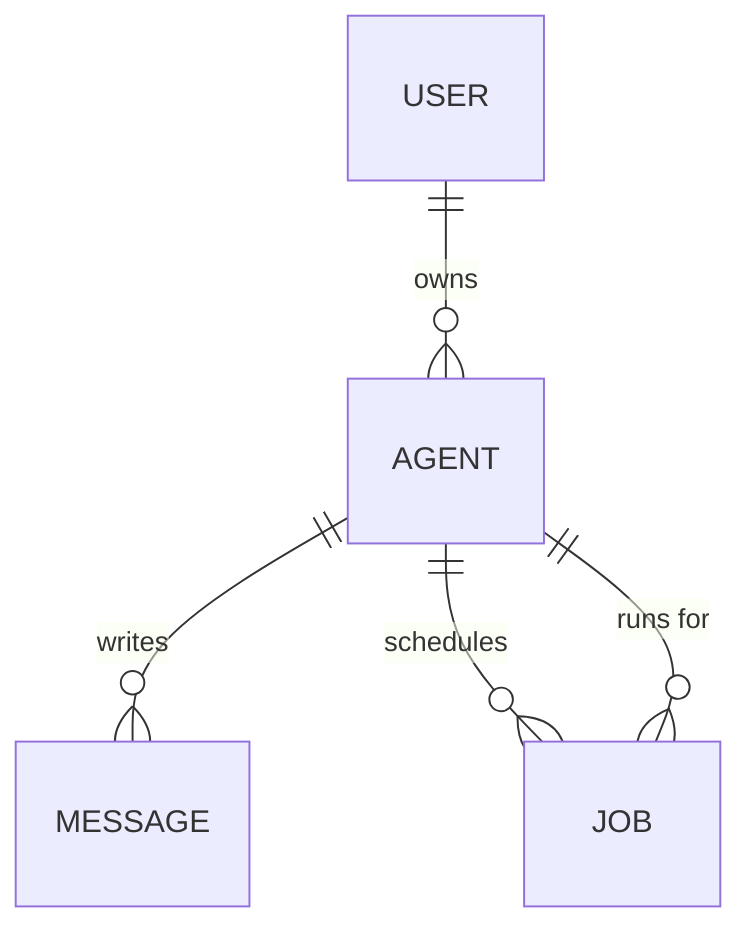
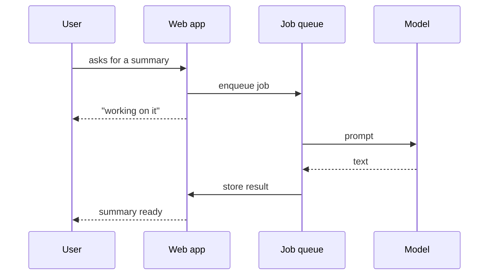
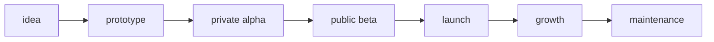

# Diagrams

A diagram shows structure faster than any paragraph. Use one whenever you explain how parts connect, where data lives, or what changes. Mermaid is the default because it is text: it lives in git, every agent can read and edit it, and many viewers (GitHub, most editors) render it. If the harness can show images, render the diagram and show it too.

Keep each diagram small: ten boxes or fewer. Draw two diagrams rather than one crowded one. Label arrows with what moves along them.

## As-built map (phase 1)

What exists and runs today. Mark planned parts with a dashed border.

## Layers (where a request lives)

See `layers.md` for the layer diagram. When you place a request, draw only the layers it touches and highlight them.

## Data model (phase 4)

## A flow over time (one feature)

## Lifecycle (phase 5)

Mark where the project is now, and keep that diagram in `docs/SCOPE.md`.
