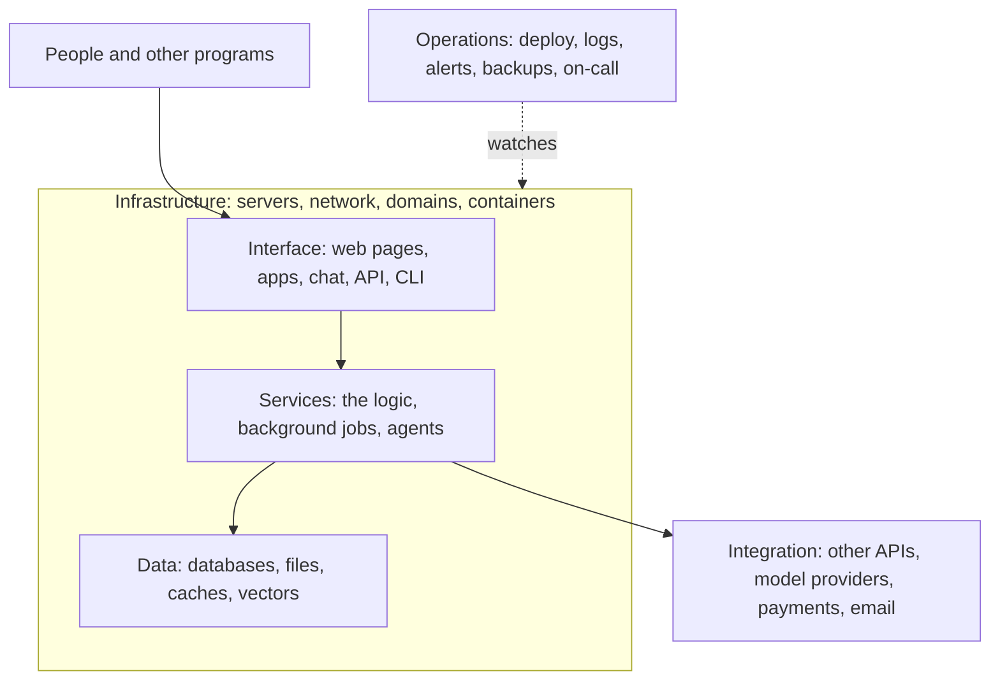

# Layers and the requirements nobody mentions

A user who has only used apps sees one layer: the screen. Every working system has at least six. Place each request on its layer, then run that layer's checks. The checks are the non-functional requirements: what the system must be, not what it does. Users never ask for them, and they are the first thing that breaks.

## Interface

What people and programs touch: pages, apps, chat bots, public APIs, command lines.

Nobody mentions:
- authentication (who are you) and authorization (what may you do) on every non-public route;
- input validation on the server, not only in the browser;
- error states, empty states and slow states;
- accessibility: keyboard use, contrast, screen readers;
- language and time zones if users are international;
- API versioning once anyone else depends on it.

## Services

The logic: request handlers, background jobs, schedulers, agents.

Nobody mentions:
- one responsibility per service, and a reason for each separate process;
- timeouts and retries on every call that leaves the process, with backoff;
- idempotency: running the same job twice must not do damage twice;
- what happens when it crashes halfway;
- concurrency: two requests changing the same thing at once;
- for agents: what tools they may use, what they may not, and a log of what they did.

## Data

Databases, files, caches, vector stores, object storage.

Nobody mentions:
- a written data model, and one owner for each kind of data;
- migrations under version control, never hand edits on production;
- backups, kept elsewhere, with a tested restore;
- personal data: what you hold, why, for how long, and how a person gets it deleted;
- indexes on frequent queries;
- a single source of truth: one place each fact lives. Copies are caches and must say so.

## Integration

Everything outside your control: model providers, payment, email, other APIs, webhooks.

Nobody mentions:
- keys and tokens stored as secrets, never in code;
- rate limits and quotas on their side;
- what your system does when they are down or slow;
- cost per call, and an alert on the bill;
- terms of service and data handling of each provider;
- treating everything they return as untrusted input. For model output this includes prompt injection.

## Infrastructure

Where it runs: servers, containers, network, domains, certificates.

Nobody mentions:
- no process runs as root; one user per service;
- only the ports that must be public are public, behind one reverse proxy;
- a firewall, automatic security updates, and SSH by key only;
- certificates renewed automatically (for example Let's Encrypt), never private keys in git;
- the server can be rebuilt from scripts, not from memory;
- resource limits so one process cannot starve the rest.

## Operations

Keeping it alive: deploy, observe, recover.

Nobody mentions:
- repeatable deploy and one-step rollback;
- logs in one place, errors reported, a health check, an uptime alert;
- backups monitored, not just configured;
- a runbook: what to do when the top failures happen;
- who gets woken up, even if the answer is "nobody, and that is accepted";
- costs reviewed every month.

## How to report the gaps

In `docs/ARCHITECTURE.md`, under each layer, list the checks as done, not done, or not needed yet with the reason. Tell the user only the top three gaps by risk, each in one sentence. The rest stay in the file.
