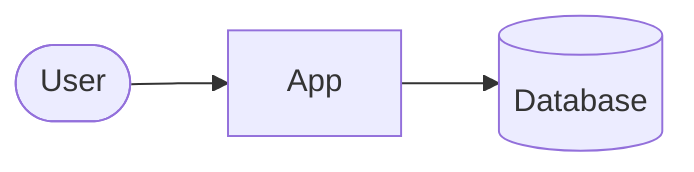

# Architecture (as built)

Updated: YYYY-MM-DD. This file describes what exists and runs. Plans go in SCOPE.md.

## Map

## Components

| Component | Standard term | Layer | Status | Runs where | One line |
|---|---|---|---|---|---|
| | | interface / services / data / integration / infrastructure / operations | running / built, not running / planned | | |

## Where state lives

<Every database, folder, cache or file that holds data that matters, and its backup.>

## Gaps per layer

For each layer: done, not done, or not needed yet (with the reason).

- Interface:
- Services:
- Data:
- Integration:
- Infrastructure:
- Operations:

## Folder structure

<One line per top-level folder.>
